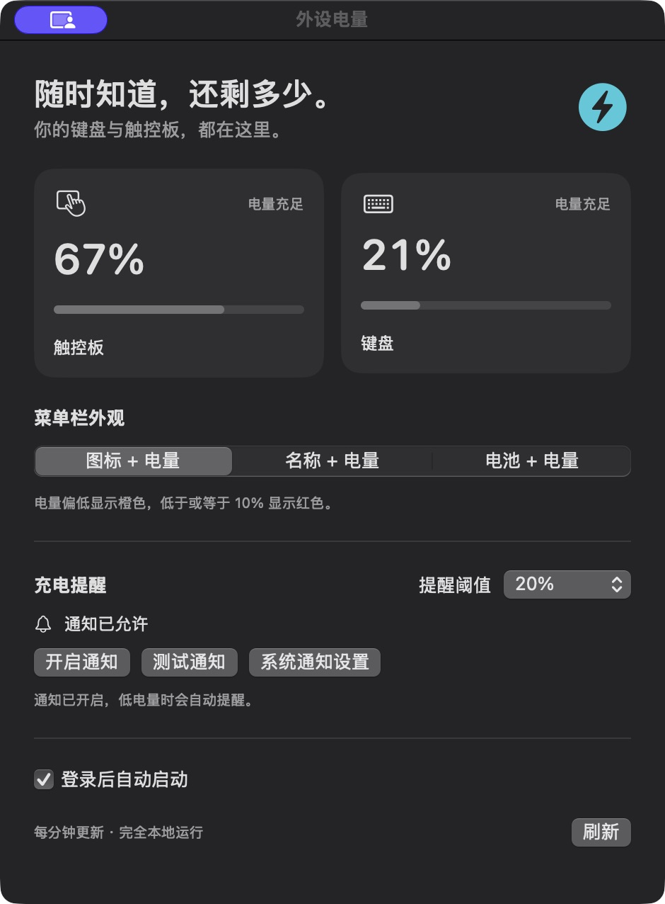

# mymac

mac使用日常中的小痛点

把日常使用 Mac 时遇到的小问题，变成自己可以掌控的小工具，也记录每一次从想法到实现的过程。

## 工具目录

| 工具 | 解决的问题 | 状态 |
| --- | --- | --- |
| [外设电量 · Peripheral Battery](peripheral-battery/) | 一眼查看苹果无线键盘、触控板电量，提前提醒充电 | v1.2.1，可直接下载 |

## 直接下载

[下载外设电量 v1.2.1（M 系列 Mac，macOS 14+）](https://github.com/moonwmh/mymac/releases/download/peripheral-battery-v1.2.1/PeripheralBattery-v1.2.1-macOS-arm64.zip) · [安装与首次打开说明](peripheral-battery/#下载使用无需编译)

解压后把“外设电量.app”拖到“应用程序”。此版本尚未经过 Apple 公证，首次打开可能需要在系统“隐私与安全性”中允许。

## 界面预览

  

[查看外设电量项目](peripheral-battery/)

## 第一份记录

2026 年 10 月 19 日，从 Mac mini 的无线外设低电量问题出发，完成了第一个菜单栏工具。

[阅读这次项目的故事](peripheral-battery/docs/PROJECT_STORY.md) · [查看构建与使用说明](peripheral-battery/README.md)
